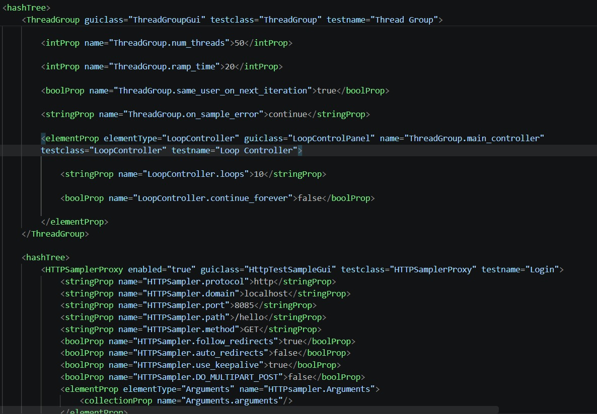
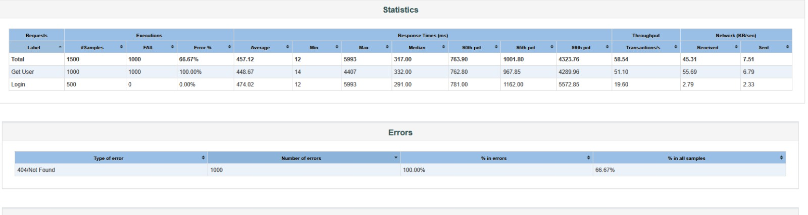

# AI Performance Testing

> Génération automatique de scénarios de test de charge JMeter à partir d'une spécification OpenAPI, pilotée par IA (Groq).


---

## 1. Overview

**AI Performance Testing** est un service FastAPI qui :
1. reçoit une spécification OpenAPI,
2. la fait analyser par un LLM (Groq) pour concevoir un scénario de test de charge réaliste,
3. génère un fichier `.jmx` correspondant,
4. l'exécute avec Apache JMeter.

## 2. Fonctionnalités

- Analyse automatique des endpoints d'une spec OpenAPI (`.yaml` / `.yml` / `.json`)
- Conception du scénario de charge par IA (threads, ramp-up, loops, ordre des requêtes)
- Génération d'un fichier `.jmx` prêt à l'exécution
- Exécution asynchrone via JMeter, suivi de job par `jobId`
- Récupération des résultats : logs, sortie standard, `.jtl`, rapport HTML

## 3. Architecture

```
Développeur
      |
      v
Spécification OpenAPI
      |
      v
Serveur IA (FastAPI + Groq)
      |
      +--> Analyse de l'API
      +--> Génération du scénario
      +--> Génération du fichier JMX
      |
      v
   JMeter
      |
      v
Résultats (JTL / rapport HTML / logs)
```

## 4. Demo

### Envoi de la spécification OpenAPI


### Scénario généré par l'IA


### Résultat de l'exécution JMeter


> Place tes captures d'écran dans `docs/images/`. Vérifie avant publication qu'aucune clé API, token, ou IP interne n'apparaît dans une capture.

## 5. Structure du projet

```
├── api/
│   ├── __init__.py
│   └── routes.py              # Endpoints API
├── models/
│   ├── __init__.py
│   ├── request_models.py      # Modèles de requête/réponse
│   └── scenario_model.py      # Modèle du scénario
├── prompts/
│   ├── __init__.py
│   ├── scenario_prompt.py     # Prompt envoyé à l'IA
│   └── system_prompt.py       # Prompt système
├── services/
│   ├── __init__.py
│   ├── api_analyzer.py        # Analyse des endpoints API
│   ├── file_service.py        # Gestion des fichiers
│   ├── groq_client.py         # Client IA Groq
│   ├── jmeter_executor.py     # Exécution JMeter asynchrone
│   ├── jmx_generator.py       # Génération du fichier JMX
│   ├── job_store.py           # Stockage des jobs en mémoire
│   ├── json_cleaner.py        # Nettoyage de la réponse JSON de l'IA
│   ├── openapi_parser.py      # Analyse des specs OpenAPI
│   ├── prism_service.py       # Intégration Prism (mock server)
│   ├── scenario_generator.py  # Génération du prompt
│   └── target_resolver.py     # Résolution de la cible de test
├── scripts/
│   ├── setup_monitoring.bat
│   └── start_test.bat
├── templates/
│   └── jmeter_template.jmx    # Template JMX de base
├── examples/
│   └── petstore.json
├── app.py                     # Application FastAPI
├── docker-compose.yml
├── Dockerfile
├── requirements.txt
├── .env.example
└── .gitignore
```

> ⚠️ Si Prometheus, Grafana ou un pipeline Jenkins font partie de ton infrastructure réelle, ajoute leurs dossiers de config (`prometheus/`, `grafana/`, `Jenkinsfile`) et documente-les dans une section dédiée. Ils ne sont pas inclus ici car absents du dépôt actuel.

## 6. Prérequis

- Python 3.13
- Apache JMeter 5.6.3+
- Une clé API Groq
- Docker 

## 7. Installation

### Local (Windows/Linux)

```
python -m venv .venv
.venv\Scripts\activate        # Windows
source .venv/bin/activate     # Linux/Mac

pip install -r requirements.txt

cp .env.example .env
# Éditez .env : GROQ_API_KEY, JMETER_BIN
```

### Docker

```
cp .env.example .env
docker-compose up -d
```

## 8. Configuration

Variables à définir dans `.env` (voir `.env.example`) :

| Variable | Description |
|---|---|
| `GROQ_API_KEY` | Clé API Groq |
| `GROQ_MODEL` | Modèle LLM utilisé |
| `JMETER_BIN` | Chemin vers l'exécutable JMeter |
| `PRISM_HOST` | URL du mock server Prism  |
| `API_HOST` / `API_PORT` | Configuration du serveur FastAPI |

## 9. Utilisation

### Démarrer le serveur
```
uvicorn app:app --host 0.0.0.0 --port 8000
# ou
docker-compose up -d
```

### Générer et exécuter un test
```
scripts\start_test.bat mon_api.yaml 50 10 5

# ou manuellement
curl -X POST http://localhost:8000/generateScenario \
  -F "file=@mon_api.yaml" \
  -F "threads=50" \
  -F "rampUp=10" \
  -F "loops=5"
```

### Suivre le status
```
curl http://localhost:8000/status/JOB_ID
curl -o jmeter.log http://localhost:8000/download/JOB_ID/log
curl -o stdout.log http://localhost:8000/download/JOB_ID/stdout
```

## 10. API REST

### `POST /generateScenario`
Multipart form :
- `file` : spécification OpenAPI (.yaml/.yml/.json) — **requis**
- `threads`, `rampUp`, `loops` : overrides optionnels

Réponse immédiate (le test tourne en tâche de fond) :
```json
{ "jobId": "...", "status": "QUEUED", "jmxFile": "generated/scenario_xxx.jmx" }
```

### `GET /status/{jobId}`
```json
{ "jobId": "...", "status": "RUNNING|COMPLETED|FAILED", "error": null }
```

### `GET /download/{jobId}/log`
Log JMeter détaillé.

### `GET /download/{jobId}/stdout`
Sortie standard de la commande JMeter.

### `GET /download/{jobId}/jtl`
Fichier de résultats bruts JMeter (`.jtl`).

### `GET /download/{jobId}/report`
Rapport HTML JMeter, zippé.

## 11. Dépannage

**Erreur 409 lors du téléchargement du rapport**
Le job n'est pas encore terminé :
```
curl http://localhost:8000/status/JOB_ID
```

**JMeter ne trouve pas le chemin**
Vérifiez `JMETER_BIN` dans `.env` :
```
JMETER_BIN=C:\jmeter\apache-jmeter-5.6.3\bin\jmeter.bat
```

## 12. Limites connues

- Le job store est en mémoire (process unique). Pour plusieurs workers/replicas, remplacez `services/job_store.py` par un backend partagé (Redis, base SQL).
- Pas d'authentification sur l'API — à ajouter avant toute exposition hors réseau interne.

## 13. Technologies

- FastAPI, Uvicorn
- Groq (LLM)
- Pydantic, PyYAML
- Apache JMeter 5.6.3+
- Docker

## Author

[@SihamBouzagrar](https://github.com/SihamBouzagrar)
## License

Ce projet a été réalisé dans le cadre d'un stage/PFA en environnement d'entreprise. Il n'est pas destiné à une réutilisation, distribution ou modification sans autorisation préalable.

All Rights Reserved 
